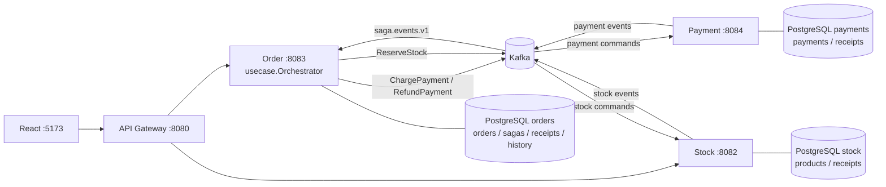
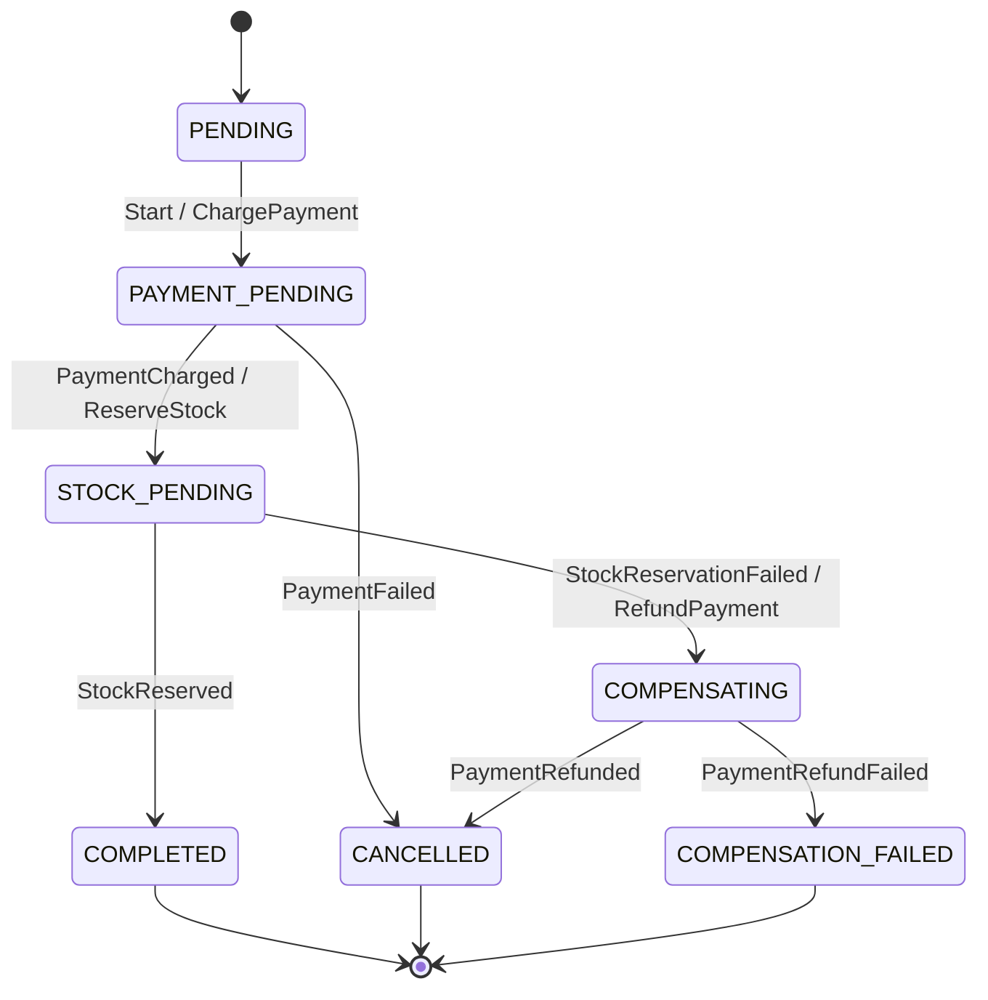
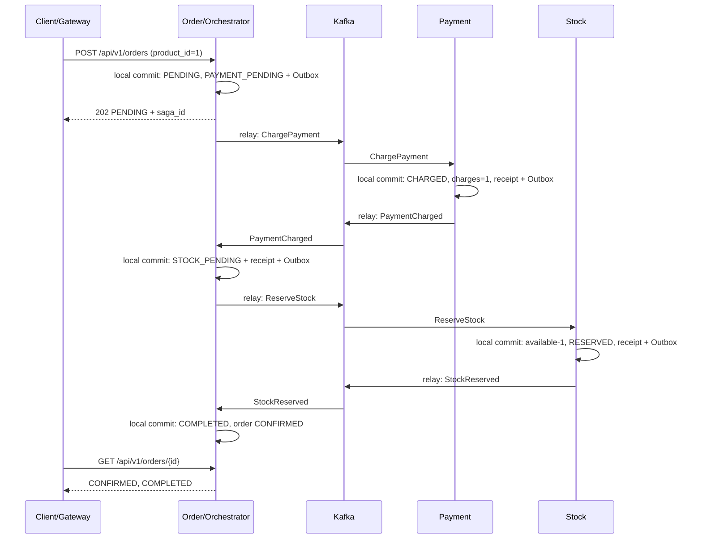

# GoDelivery: EDA и Orchestrated Saga — 90 минут

Цель: увидеть бизнес-процесс между сервисами с собственными БД без общей
ACID-транзакции. Студенты уже знакомы с Event Storming и Strangler Fig.
Основной пример: **оплата прошла → Stock отказал → Saga инициировала возврат
→ деньги возвращены → заказ отменён**.

В ветке находится задание для совместной работы. Студенты дописывают методы
`Saga.Start` и `Saga.Apply` в `order-service/internal/domain/saga.go`. Таблица
состояний и диаграммы ниже задают требования. Раздел Live Demo содержит сценарии
проверки. Их ожидаемые финальные состояния относятся к выполненному заданию.
Для самостоятельного часового практикума выдайте [STUDENT_TASK.md](STUDENT_TASK.md).
Студент сдаёт доменные тесты, Happy Path и компенсацию. В 90-минутном занятии
остальные демонстрации можно разобрать вместе с группой.

## Подготовка преподавателя

Требуются Docker Desktop/Engine с Compose v2, Python 3.9+, `make`, браузер.
Для разработки и модульных тестов установите Go 1.23+. Сервисы запускаются в Docker.
Первый запуск загружает образы и зависимости; выполните его до занятия.
Предусмотрите около 4 ГБ памяти Docker. Никаких настоящих платежей нет.

```bash
# Остановить прежний стенд, если он работает: порты пересекаются.
docker compose down
# Также остановить локальные Order/Payment/Stock от прошлого семинара.
make saga-up
make saga-acceptance
```

На исходной заготовке контейнеры готовы, а тесты Order падают на двух TODO.
Выполните `make saga-demo-happy` и покажите студентам `FAILURE`, HTTP 503
и `TODO Saga.Start`. Локальная транзакция создания заказа откатилась. После
выполнения задания тот же сценарий должен завершиться `SUCCESS happy`.

`.env` для Saga не нужен; Compose содержит безопасные демонстрационные значения.
`compose.saga.yaml` — самостоятельная конфигурация, её не нужно объединять
через `-f docker-compose.yaml -f compose.saga.yaml`. Старый Compose сохранён.
Все дальнейшие команды выполняются из корня ветки `feat_saga_orchestration_seminar`.

Адреса: React `http://localhost:5173`, Gateway `:8080`, Stock `:8082`, Order
`:8083`, Payment `:8084`, PostgreSQL `localhost:15432`, Kafka `localhost:19092`.
Swagger: `http://localhost:8080/swagger/index.html` и `:8083/swagger/index.html`.
Порты опубликованы только на loopback. Jaeger доступен на `http://localhost:16686`,
экспорт OTel включён; ссылка из React открывает трассу покупки. Grafana и
Prometheus в Saga-стенде не запускаются.

Интерактивные диаграммы Archify для показа на занятии:
[контейнеры, компоненты, sequence и три ERD](docs/diagrams/saga-index.html).

В одном терминале оставьте:

```bash
make saga-logs
```

В другом запускайте демонстрации. Они автоматически ждут готовности Compose,
поллят условия с дедлайном, печатают историю и проверяют три БД. Фиксированного
«подождать пять секунд и считать успехом» нет. `SUCCESS` означает проверенные
бизнес-эффекты, `FAILURE` и ненулевой exit code — несоответствие/таймаут.
Для уже работающего стенда можно пропустить повторный build/up:
`python3 scripts/saga_demo.py compensation --no-start`.

## Исследованная архитектура и принятое решение

Изначально репозиторий содержит Monolith, Gateway, React, Stock, Payment, Order,
один Go-модуль, Kafka KRaft и наблюдаемость. PostgreSQL и Outbox не было.
Order резервировал Stock синхронным HTTP-вызовом, затем публиковал
`order-created`; Payment отвечал `payment-completed`. Данные — process-local map.
Бизнес-правила находятся в `internal/domain` и `internal/usecase`, адаптеры —
`repository`, `delivery`/`handler`; `main.go` выполняет ручную сборку зависимостей.
Тесты проверяли Strangler-маршруты, оплату, конкурентный резерв, OTel headers.
`cmd/lab` переключает четыре флага предыдущей миграции:
`ROUTE_STOCK_TO_MICROSERVICE`, `ROUTE_ORDER_TO_MICROSERVICE`,
`ASYNC_PAYMENT_ACTIVE`, `MONOLITH_STOCK_BRIDGE_ACTIVE`.

Целевое изменение: тот же Order становится оркестратором в usecase-слое;
существующие Payment/Stock получают Kafka-команды и SQL-репозитории.
`SAGA_ENABLED` выбирает этот режим в трёх `main.go`; при false прежний режим
сохранён. Создавать четвёртый сервис-оркестратор не требуется: процесс является
частью оформления заказа. Gateway/API/React переиспользованы. Набор проверок:
машина состояний, прежние тесты, реальные Kafka/SQL сценарии A–D и отказ возврата,
перезапуск участников, проверка учебной заготовки и чистый Compose-запуск.

Используется один PostgreSQL контейнер с тремя **разными базами и пользователями**.
Это экономит ресурсы ноутбука. Роли не могут подключаться к чужим БД.
Сервисы не делают межбазовых SQL-запросов. Скрипт преподавателя читает каждую
БД её владельцем, чтобы показать результат, и не участвует в бизнес-процессе.



## Часть 1. Основы Event-Driven Architecture — 20 минут

**0–5 минут.** Вспомните Event Storming. «Оплата проведена», «Товар
зарезервирован» — уже выделенные бизнес-факты. Теперь превращаем их в контракты
и передаём между процессами. При синхронном HTTP вызывающий ждёт ответ и зависит
от доступности вызываемого прямо сейчас. При асинхронном обмене producer пишет
сообщение в Kafka, consumer обработает его позже. HTTP 202 подтверждает приём
заказа, а итог читается отдельным GET.

**5–10 минут. Command vs Event.** Команда просит выполнить действие:
`ChargePayment`, `ReserveStock`, `RefundPayment`. У неё конкретный исполнитель,
который может отказать. Событие фиксирует результат:
`PaymentCharged`, `StockReservationFailed`, `PaymentRefunded`.
Оркестратор отправляет команды; участники публикуют события. Другие подписчики
могут независимо читать факты для аналитики/уведомлений. Команда «верни деньги»
сама по себе ещё не доказывает, что деньги возвращены.

Откройте `internal/sagacontract/message.go` и `docs/SAGA_CONTRACTS.md`.
Покажите `event_id`, `order_id`, `saga_id`, `message_type`, `schema_version`,
`created_at`, `data`. `order_id` связывает данные участника, `saga_id` — процесс,
`event_id` — сообщение. Все денежные значения — целые копейки.

**10–15 минут. Kafka.** Producer отправляет в топик, consumer читает партицию
и подтверждает offset. Consumer group распределяет партиции между экземплярами
одного логического подписчика. Разные группы читают один поток независимо.
Топики команд разделены по исполнителям; ответы участников идут в
`saga.events.v1`. Группа Order — `saga-order-v1`, Payment — `saga-payment-v1`,
Stock — `saga-stock-v1`. Kafka key — `saga_id`; в стенде одна партиция на топик.

Kafka хранит журнал, поддерживает порядок внутри партиции и повторное чтение.
Порядка между топиками и общей транзакции с нашими PostgreSQL БД нет.
Повторы возможны. Один брокер с replication factor 1 выбран для ноутбука,
а не для отказоустойчивого production. Первичные материалы:
[Kafka design](https://kafka.apache.org/39/design/design/),
[kafka-go explicit commits](https://github.com/segmentio/kafka-go#explicit-commits).

**15–20 минут. Eventual Consistency.** Между HTTP 202 и финальным событием
заказ находится в `PENDING`. Payment уже может иметь `CHARGED`, пока Order
ещё ждёт его сообщение. Это наблюдаемое промежуточное состояние. «Eventually»
означает сходимость при успешной доставке и обработке; оно не исправляет
потерянное сообщение автоматически. Плюсы EDA: меньше временной связанности,
независимые подписчики, буферизация. Минусы: задержка видимости результата,
повторы, восстановление после сбоя, эволюция схем и более сложная диагностика.

## Часть 2. Зачем нужна Saga — 15 минут

**20–25 минут.** Нарисуйте три локальные транзакции. Order сохраняет заказ,
Saga и её историю. Payment сохраняет результат оплаты и кеш ответа. Stock
сохраняет резерв и уменьшение остатка. Каждый commit относится только к одной БД.
`*sql.Tx` явно передаётся в методы репозитория; в `context.Context` его нет.

**25–30 минут.** Спросите: «Что откатит commit Payment, если Stock откажет?»
Общей транзакции нет. Простое изменение `orders.status` не возвращает деньги.
Нужна новая операция Payment — возврат. Она имеет собственные правила, может
завершиться ошибкой и оставляет историю. Это **компенсация**, а не SQL rollback.

**30–35 минут.** Оплата → резерв выбраны специально, чтобы сделать компенсацию
видимой. Для настоящего продукта часто разумнее авторизовать средства, затем
резервировать и только после этого списывать. Возврат может занимать время,
иметь комиссию и не отменять все последствия исходной операции. Наш платёж —
изменение учебной записи в БД, никакой внешний провайдер не вызывается.

## Часть 3. Orchestrated Saga — 15 минут

**35–40 минут.** Реализуйте со студентами первый переход в `Saga.Start`. Проследите, как команда этого метода попадает в Outbox. Откройте `order-service/internal/usecase/saga.go`:
`Orchestrator.Create`, `Orchestrator.Handle`; затем
`order-service/internal/domain/saga.go`: `Saga.Start`, `Saga.Apply`.
Usecase управляет локальной транзакцией и записью Outbox; relay публикует сообщения. Домен определяет
переход и следующую команду; Kafka handler только декодирует DTO и делегирует.
Оркестратор знает последовательность, участники знают только свои операции.

**40–45 минут.** Добавьте в `Saga.Apply` переходы успешной оплаты и резерва. Проверьте тестом `go test ./order-service/internal/domain -run TestSagaBusinessOutcomes/happy`. Остальные строки таблицы понадобятся для сценариев отказа. Статус заказа остаётся `PENDING`, пока
не получено финальное подтверждение.

| Текущее состояние | Факт / действие | Следующее состояние | Следующая команда / заказ |
|---|---|---|---|
| PENDING | Start | PAYMENT_PENDING | ChargePayment |
| PAYMENT_PENDING | PaymentCharged | STOCK_PENDING | ReserveStock |
| PAYMENT_PENDING | PaymentFailed | CANCELLED | заказ CANCELLED |
| STOCK_PENDING | StockReserved | COMPLETED | заказ CONFIRMED |
| STOCK_PENDING | StockReservationFailed | COMPENSATING | RefundPayment |
| COMPENSATING | PaymentRefunded | CANCELLED | заказ CANCELLED |
| COMPENSATING | PaymentRefundFailed | COMPENSATION_FAILED | заказ PENDING; нужен разбор |

Неизвестный/недопустимый переход возвращает `ErrTransition` без изменения
состояния. Уже обработанный факт отсекается устойчивым receipt до `Apply`.
Отдельное `PAYMENT_COMPLETED` не хранится: принятие `PaymentCharged` и решение
отправить `ReserveStock` составляют один локальный переход.



**45–50 минут.** Сравните orchestration и choreography. Здесь один usecase
говорит, что делать дальше; полную цепочку легко прочитать. При хореографии
каждый участник сам реагирует на факты, а процесс распределён между ними.
Для коротких независимых реакций это удобно; для процесса с компенсацией
центральная последовательность упрощает контроль. Это не универсальный engine:
нет регистрации шагов, рефлексии, Temporal/Camunda или DSL.

## Часть 4. Live Demo — 30 минут

Для каждого следующего сценария сначала прочитайте его тест и добавьте в
`Saga.Apply` соответствующий переход. Команды demo пересобирают контейнер Order
из текущего кода. Для сценария D используйте уже подготовленную обработку
повторов в `Orchestrator.Handle` и посмотрите, какие записи реально изменились.

### 50–56 минут. A — успешная Saga

```bash
make saga-demo-happy
```

Скрипт создаёт `{"product_id":1,"quantity":1}`. Покажите HTTP 202 с `PENDING`,
затем историю `PAYMENT_PENDING → STOCK_PENDING → COMPLETED`.
В SQL: Order `CONFIRMED`, Payment `CHARGED`, `charges=1`, `refunds=0`,
Stock `RESERVED`, остаток уменьшен на 1. Скрипт проверяет фактический остаток
относительно всех успешных резервов, поэтому демонстрации можно повторять.
Ожидаемый результат — `SUCCESS happy`.



Исходники: `Saga.Apply`; `payment-service/internal/usecase/saga.go: Handle`,
`payment-service/internal/domain/saga.go: Charge`;
`stock-service/internal/usecase/saga.go: Handle`,
`stock-service/internal/domain/saga.go: ReserveAvailable`.

### 56–61 минут. B — оплата отклонена

```bash
make saga-demo-payment-failed
```

Запрос: `{"product_id":1,"quantity":1,"demo_failure":"payment"}`.
В логах: `ChargePayment → PaymentFailed`, затем Order `CANCELLED`.
SQL: Payment `DECLINED`, `charges=0`, `refunds=0`; записи Stock для заказа нет.
Скрипт дополнительно проверяет отсутствие решения `ReserveStock` в истории.
Ожидается `SUCCESS payment-failed`. Код: `SagaPayment.Charge` и ветка
`PaymentFailed` в `Saga.Apply`. Бизнес-отказ подтверждается и не повторяется
как техническая ошибка.

### 61–71 минут. C — главная демонстрация компенсации

```bash
make saga-demo-compensation
```

Товар 2 имеет нулевой остаток, цена положительная. Никакой ручной правки БД.
Скрипт выводит точные order_id/saga_id, а затем проверенную последовательность:

```text
OrderCreated -> PENDING
SagaStarted -> PAYMENT_PENDING -> ChargePayment (Payment)
PaymentCharged -> STOCK_PENDING -> ReserveStock (Stock)
StockReservationFailed -> COMPENSATING -> RefundPayment (Payment)
PaymentRefunded -> CANCELLED
SUCCESS compensation
```

Объясняйте каждую строку: Payment сначала зафиксировал списание; Stock отказал
без уменьшения остатка; **Order**, получив отказ, решил вернуть деньги;
Payment подтвердил возврат; только теперь Order отменил заказ.

```mermaid
sequenceDiagram
    participant C as Client/Gateway
    participant O as Order/Orchestrator
    participant K as Kafka
    participant P as Payment
    participant S as Stock
    C->>O: POST /api/v1/orders (product_id=2)
    O->>O: commit PENDING, PAYMENT_PENDING + Outbox
    O-->>C: 202 PENDING
    O->>K: relay: ChargePayment
    K->>P: ChargePayment
    P->>P: commit CHARGED, charges=1 + Outbox
    P->>K: relay: PaymentCharged
    K->>O: PaymentCharged
    O->>O: commit STOCK_PENDING + Outbox
    O->>K: relay: ReserveStock
    K->>S: ReserveStock
    S->>S: available=0; commit REJECTED, receipt + Outbox
    S->>K: relay: StockReservationFailed
    K->>O: StockReservationFailed
    O->>O: commit COMPENSATING + Outbox
    O->>K: relay: RefundPayment
    K->>P: RefundPayment
    P->>P: commit REFUNDED, refunds=1 + Outbox
    P->>K: relay: PaymentRefunded
    K->>O: PaymentRefunded
    O->>O: commit CANCELLED, order CANCELLED
```

В логах ищите JSON-поля `service`, `order_id`, `saga_id`, `message_type`,
`saga_state`, `next_command`, `result`, `duplicate`. Пример перехода:

```json
{"msg":"saga transition","service":"order-service","order_id":"order-...","saga_id":"saga-...","message_type":"StockReservationFailed","saga_state":"COMPENSATING","next_command":"RefundPayment","duplicate":false}
```

Payment/Stock не владеют текущим состоянием Saga, поэтому `saga_state` у них
пустое; Payment дополнительно пишет `payment_state`. Это не распределённая
копия состояния оркестратора.

Код: `Saga.Apply` (ветки `StockReservationFailed`, `PaymentRefunded`),
`Orchestrator.Handle`, `SagaPayment.Refund`, SQL `Save` каждого участника.
Скопируйте `order_id` и `saga_id` этого прогона. Покажите запросы к трём
базам и историю команд для этого заказа по [инструкции студента](STUDENT_TASK.md#sql-для-одного-заказа).
Ожидаются заказ и Saga `CANCELLED` с причиной `insufficient_stock`, платёж
`REFUNDED` с одним списанием и одним возвратом, резерв `REJECTED` для товара 2.

### 71–78 минут. D — дубли сообщений

```bash
make saga-demo-duplicate
```

Скрипт проводит успешную покупку, повторно публикует `PaymentCharged`,
`ChargePayment`, `ReserveStock`, `StockReserved`, включая новые `event_id`.
Затем проводит компенсацию и повторяет `RefundPayment`/`PaymentRefunded`.
Повторы отправляются настоящим Kafka producer, не прямым вызовом usecase.
Скрипт ждёт роста `deliveries` в БД нужного consumer: это доказывает обработку
дубля. Проверяется неизменность истории и бизнес-данных: списание/возврат по 1.
Вывод: `SUCCESS duplicate: charges=1, refunds=1; history unchanged`.

Код: Order `SagaStore.Receipt` перед `Saga.Apply`, Payment `SagaStore.Result`,
Stock `SagaStore.Result`; `scripts/saga_demo.py: duplicate, replay, verify`.
Повтор может вызвать повторную отправку уже сохранённого решения, но участник
использует кешированный результат и прежний ID Outbox. Это идемпотентность, а не exactly-once delivery.

### 78–80 минут. Ошибка компенсации

```bash
make saga-demo-refund-failed
```

Вход: товар 2, `demo_failure=refund`. SQL: Payment `REFUND_FAILED`, `charges=1`,
`refunds=0`; Saga `COMPENSATION_FAILED`; заказ остаётся `PENDING`.
Ожидается `SUCCESS refund-failed`: проверка корректного отрицательного результата.
Покажите, почему помечать такой заказ «успешно отменён и деньги возвращены»
было бы ошибкой. Автоматического повторного возврата/ручного UI здесь нет.

## Часть 5. Обсуждение — 10 минут

**80–90 минут.** Вопросы и ориентиры для ответа:

1. Чем событие отличается от команды? Факт уже произошёл, команда только просит действие.
2. Почему оркестратор знает порядок? Это владелец целого процесса оформления заказа.
3. Чем Saga отличается от ACID-транзакции? Локальные commit уже видимы; общей изоляции нет.
4. Почему возврат — не rollback? Это новая бизнес-операция со своим результатом и отказами.
5. Сервис упал после БД, до Kafka — что дальше? Outbox сохранил намерение; relay продолжит после рестарта. Почему всё ещё возможны дубли?
6. Зачем идемпотентность? Сбой подтверждения/публикации может привести к повтору уже выполненного действия.
7. Когда choreography, когда orchestration? Независимые реакции против явной последовательности с компенсациями.
8. Что решают Outbox, Retry и DLQ? Надёжное намерение отправки, временные ошибки и изоляция плохих сообщений. Что остаётся для сверки зависших процессов?

## Транзакции и пределы надёжности

Домен не импортирует SQL/Kafka/HTTP. Usecase начинает `*sql.Tx`, явно передаёт
его репозиториям и вызывает commit. Kafka handler не содержит переходов.
Дедупликация и бизнес-эффект хранятся в одной БД. Kafka offset подтверждается
после commit бизнес-эффекта, receipt и исходящего сообщения Outbox.
Фоновый relay в том же процессе отправляет намерения в Kafka, повторяет ошибки
публикации с backoff и восстанавливается после рестарта. Сбой между publish и
отметкой published_at даёт повтор, поэтому receipts остаются необходимыми.

Постоянные ошибки сообщений отправляются в `<topic>.dlq`; технические ошибки
handler повторяются до трёх записанных попыток. Карантин и исходящее DLQ-сообщение
сохраняются одной транзакцией до подтверждения исходного offset. Если БД
недоступна, offset удерживается. Бизнес-отказы — обычные события, не DLQ.
Карантин результата может оставить конкретную Saga для ручного разбора.

Дополнительные демонстрации: `make saga-demo-outbox`, `make saga-demo-dlq`.
Первая показывает HTTP 202 при остановленной Kafka и завершение после рестарта.
Вторая — исходное сообщение в DLQ, лимит технических повторов и следующий
успешный заказ. Подробный разбор: [docs/RELIABILITY.md](docs/RELIABILITY.md).
Их можно использовать после основного занятия или в рамках обсуждения.

## Сдача часового практикума

1. `make saga-acceptance` проходит для всех доменных пакетов.
2. `make saga-demo-happy` завершается `SUCCESS happy`. Студент показывает для своего заказа оплату, резерв и итоговый статус.
3. `make saga-demo-compensation` завершается `SUCCESS compensation`. Студент находит решение о возврате в истории и объясняет, какое событие разрешило отменить заказ.

## Полная регрессия для преподавателя или CI

Следующие проверки выполняют на завершённой реализации отдельно от часового
практикума. Для проверки базовой демонстрации используйте ветку
`feat_saga_orchectration_demo` в отдельной рабочей копии. Запускайте один стенд
за раз. На заготовке ожидается RED из раздела подготовки.

```bash
go vet ./...
go test -race ./...
go test -tags=acceptance ./order-service/...
make saga-up
make saga-integration
make saga-e2e
make regression-strangler
```

`make saga-integration` проверяет локальные транзакции в PostgreSQL, включая
откат при ошибке записи Outbox, повторную доставку и конкурентные дубли оплаты.
`make saga-e2e` дополнительно проверяет восстановление после сбоя брокера, DLQ
и трассу Jaeger. `make regression-strangler` проверяет четыре этапа предыдущего семинара.

Повторные сценарии используют новые ID и не требуют очистки. Обычная остановка
`make saga-down` сохраняет данные. **Полный сброс удаляет учебные данные
PostgreSQL и Kafka только проекта godelivery-saga**:

```bash
make saga-reset
make saga-up
make saga-e2e
```

Для чистого прогона остановите работающий стенд командой `make saga-down`.
Из корня ветки выполните следующие команды. Уникальное
имя проекта даёт новые тома Kafka и PostgreSQL. Порты стенда должны быть свободны.

```bash
export COMPOSE_PROJECT_NAME="godelivery-check-$(date +%s)"
make saga-up
make saga-integration
make saga-e2e
make saga-down
unset COMPOSE_PROJECT_NAME
```

Если запуск не удался: `docker compose -f compose.saga.yaml ps -a`, затем
`docker compose -f compose.saga.yaml logs --tail=100 postgres kafka order-service
payment-service stock-service`. Неготовность БД устраняется healthcheck и
миграцией до `/ready`; после изменения схемы этой версии нужен явный учебный
сброс, существующий volume автоматически не удаляется.
