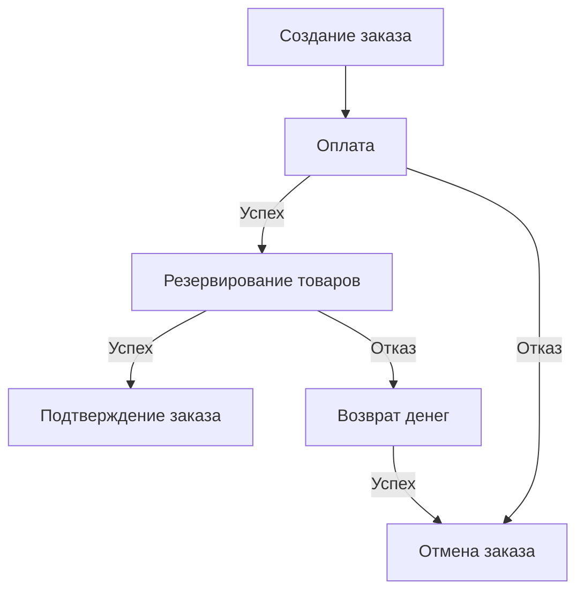
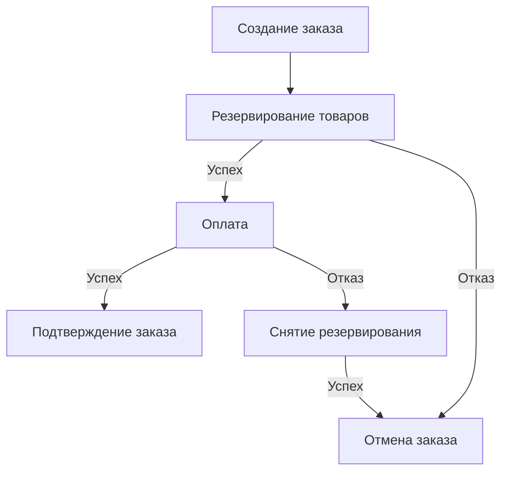

# Практическая работа: изменение бизнес-процесса Saga

**Проект:** GoDelivery  
**Продолжительность:** 60 минут  
**Ветка:** `feat_saga_orchestration_seminar`

## 1. Цель практической работы

Закрепить на практике следующие архитектурные концепции:

- Event-Driven Architecture (EDA).
- Асинхронное взаимодействие микросервисов.
- Commands и Events.
- Orchestration-based Saga.
- Управление состоянием распределённого бизнес-процесса.
- Локальные транзакции.
- Компенсирующие операции.
- Eventual Consistency.

В рамках задания необходимо изменить существующий
бизнес-процесс оформления заказа, сохранив архитектуру
приложения и принципы взаимодействия микросервисов.

## 2. Исходное состояние

В GoDelivery уже реализован паттерн Orchestrated Saga.

В бизнес-процессе участвуют три микросервиса:

| Сервис | Ответственность |
|---|---|
| Order Service | Управление заказами и оркестрация Saga |
| Payment Service | Проведение оплаты и возврат денег |
| Stock Service | Управление остатками и резервирование товаров |

Микросервисы взаимодействуют посредством команд и событий,
передаваемых через Kafka.

Каждый микросервис самостоятельно управляет своими данными
и выполняет операции в рамках локальных транзакций.

### Текущий бизнес-процесс



Недостаток текущего процесса заключается в том, что деньги
могут быть списаны за товары, которых нет в наличии.

Ваша задача — изменить этот бизнес-процесс в соответствии
с новой User Story.

## 3. Целевое поведение



Обратите внимание: изменяется не только порядок выполнения
операций, но и компенсирующая операция.

Вам предстоит самостоятельно определить, какие изменения
необходимо внести в Saga Orchestrator и её участников.

## 4. План работы

| Время | Этап |
|---|---|
| 0–10 мин | Исходная демонстрация, RED и знакомство с кодом |
| 10–25 мин | Проектирование и изменение порядка шагов |
| 25–45 мин | Снятие резерва и обработка подтверждения |
| 45–60 мин | Тесты, Happy Path и проверка данных |

Рекомендуется заранее загрузить необходимые Docker-образы
и подготовить локальное окружение.

## 5. Шаг 1. Подготовка окружения

Переключитесь на ветку самостоятельного задания:

```bash
git switch feat_saga_orchestration_seminar
```

Запустите приложение согласно инструкции в README проекта.

Проверьте состояние контейнеров:

```bash
docker compose -f compose.saga.yaml ps
```

Запустите `make saga-acceptance` для исходного процесса.
Затем запустите `make saga-assignment` и `make saga-assignment-stock`.

Тесты исходного процесса проходят. Проверки задания показывают, что первая
команда пока `ChargePayment` и действующий Stock не выполняет `ReleaseStock`.

Это ожидаемое поведение: тесты проверяют новое
бизнес-требование, которое ещё не реализовано.

### Ожидаемый результат

- [ ] Приложение запущено.
- [ ] Необходимые инфраструктурные компоненты доступны.
- [ ] Автоматические тесты запускаются.
- [ ] Тесты нового бизнес-требования находятся в состоянии RED.

Прочитайте причины RED и найдите переходы, которые приводят к текущему результату.

## 6. Шаг 2. Изучение существующего кода

Перед написанием кода необходимо понять, как работает
текущий бизнес-процесс.

Не требуется изучать весь проект. Сосредоточьтесь
на следующих компонентах.

### 6.1. Order Service и Saga Orchestrator

Найдите код, отвечающий за:

- Создание заказа.
- Запуск нового экземпляра Saga.
- Хранение состояния Saga.
- Отправку команд участникам Saga.
- Обработку событий от участников Saga.
- Подтверждение и отмену заказа.

Ответьте на вопросы:

1. Где определяется первая операция Saga?
2. Как оркестратор определяет следующий шаг?
3. Где хранится текущее состояние Saga?
4. При каких условиях Saga считается завершённой?
5. Где принимается решение о выполнении компенсации?

### 6.2. Stock Service

Найдите код, отвечающий за:

- Получение команды резервирования товаров.
- Проверку доступного количества товаров.
- Создание резерва.
- Изменение доступного остатка товара.
- Публикацию результата резервирования.

Ответьте на вопросы:

1. Как система определяет, что товара достаточно?
2. Как изменяется доступный остаток?
3. Где находятся границы локальной транзакции?
4. Какие данные позволяют идентифицировать созданный резерв?
5. Существует ли операция снятия резервирования?

### 6.3. Payment Service

Найдите код, отвечающий за:

- Получение команды оплаты.
- Выполнение оплаты.
- Обработку отказа оплаты.
- Публикацию результата оплаты.
- Выполнение возврата денежных средств.

Обратите особое внимание на существующую реализацию
возврата денежных средств.

Она поможет понять, как в проекте реализованы
компенсирующие операции.

### 6.4. Контракты сообщений

Изучите существующие команды и события Kafka.

Определите:

- Какие команды отправляет оркестратор.
- Какие сервисы обрабатывают эти команды.
- Какие события публикуют участники Saga.
- Как сообщения связываются с конкретным заказом
  и экземпляром Saga.

### 6.5. Автоматические тесты

Изучите тесты, подготовленные для самостоятельного задания.

Обратите внимание на:

- Начальное состояние системы.
- Входные данные.
- Ожидаемые команды и события.
- Ожидаемое итоговое состояние.
- Причины падения тестов.

Тесты являются дополнительной спецификацией
нового бизнес-требования.

### Ожидаемый результат

Вы можете объяснить, как существующая Saga выполняет
успешный сценарий и почему при отказе резервирования
инициируется возврат денежных средств.

## 7. Шаг 3. Спроектируйте изменения

Прежде чем изменять код, определите необходимые изменения
в бизнес-процессе.

### 7.1. Определите последовательность операций

Для каждой операции определите:

- Кто инициирует операцию?
- Какой сервис выполняет операцию?
- Какое событие сообщает об успешном выполнении?
- Какое событие сообщает об отказе?
- Что должен сделать оркестратор после получения результата?

### 7.2. Определите компенсации

Заполните таблицу самостоятельно:

| Сценарий | Выполненные операции | Необходимая компенсация |
|---|---|---|
| Все операции успешны | | |
| Резервирование отклонено | | |
| Оплата отклонена | | |

### 7.3. Определите изменения состояний Saga

Подумайте:

- Какие существующие состояния можно переиспользовать?
- Потребуются ли новые состояния?
- Как отличить ожидание результата операции от её завершения?
- Как определить, что Saga находится в процессе компенсации?
- В какой момент можно окончательно отменить заказ?

### 7.4. Определите изменения контрактов

Проверьте, достаточно ли существующих команд и событий
для реализации нового бизнес-процесса.

Для новой операции подготовлены команда `ReleaseStock` и событие
`StockReleased`. Используйте эти имена при реализации.

### Ожидаемый результат

У вас есть понятный план изменений, и вы можете объяснить
поведение Saga для каждого из трёх бизнес-сценариев.

## 8. Шаг 4. Измените логику Saga Orchestrator

Начните с реализации основного бизнес-сценария.

### 8.1. Измените порядок выполнения операций

Необходимо обеспечить выполнение резервирования товаров
до проведения оплаты.

Для этого изучите:

- Инициализацию Saga.
- Обработчики результатов резервирования.
- Обработчики результатов оплаты.
- Условия перехода между состояниями Saga.

Используйте существующие механизмы публикации команд
и обработки событий.

Не заменяйте асинхронное взаимодействие прямыми HTTP-
или gRPC-вызовами между участниками Saga.

### 8.2. Обработайте успешное выполнение операций

Убедитесь, что заказ подтверждается только после
успешного выполнения всех необходимых операций.

### 8.3. Обработайте отказ резервирования

При недостаточном количестве товаров заказ должен
быть отменён.

Убедитесь, что в этом сценарии не выполняются
ненужные бизнес-операции.

### 8.4. Запустите тесты

Запустите проверки порядка операций.

```bash
go test -tags=saga_assignment ./order-service/internal/domain -run 'TestAssignment(ReserveBeforePayment|NoPaymentWhenStockRejects)'
```

Проверьте, какие тесты уже перешли в состояние GREEN,
а какие требуют дальнейшей реализации.

### Ожидаемый результат

- [ ] Резервирование выполняется до оплаты.
- [ ] Успешное выполнение операций приводит к подтверждению заказа.
- [ ] Отказ резервирования приводит к отмене заказа.
- [ ] При отказе резервирования оплата не инициируется.
- [ ] Соответствующие автоматические тесты проходят.

## 9. Шаг 5. Реализуйте компенсирующую операцию

Теперь рассмотрите ситуацию, при которой товары уже
зарезервированы, но оплата заказа отклонена.

В этом случае система должна восстановить доступность
ранее зарезервированных товаров.

### 9.1. Реализуйте снятие резервирования в Stock Service

Изучите существующую операцию резервирования.

Определите, какие изменения данных необходимо выполнить,
чтобы компенсировать её результат.

При реализации учитывайте следующие требования:

- Операция относится к конкретному резерву.
- Необходимо восстановить корректное количество товара.
- Связанные изменения данных должны выполняться
  в одной локальной транзакции.
- Stock Service не должен напрямую изменять состояние заказа.
- Результат операции должен быть доступен оркестратору
  посредством событийного взаимодействия.

Не нарушайте существующие механизмы идемпотентности.

### 9.2. Интегрируйте компенсацию в Saga

Измените логику оркестратора так, чтобы при отказе оплаты
после успешного резервирования запускалась необходимая
компенсирующая операция.

Оркестратор должен учитывать результат её выполнения.

Не переводите заказ в окончательное состояние отмены,
пока необходимая компенсация не подтверждена.

### 9.3. Проверьте границы ответственности

Убедитесь, что:

- Оркестратор управляет последовательностью операций.
- Stock Service отвечает за изменение остатков.
- Payment Service отвечает за оплату.
- Участники Saga не управляют всем бизнес-процессом.
- Каждый сервис работает только со своими данными.

### Ожидаемый результат

- [ ] При отказе оплаты инициируется компенсация.
- [ ] Ранее созданный резерв снимается.
- [ ] Доступный остаток товара восстанавливается.
- [ ] Saga корректно ожидает результат компенсации.
- [ ] Заказ окончательно отменяется после успешной компенсации.

## 10. Шаг 6. Запустите автоматические тесты

Запустите все обязательные тесты самостоятельного задания.

Запустите `make saga-assignment`, `make saga-assignment-stock` и
`make saga-assignment-e2e`. Последняя команда пересобирает стенд.

Если тест завершается ошибкой:

1. Прочитайте сообщение об ошибке.
2. Определите ожидаемое и фактическое поведение.
3. Найдите соответствующий участок бизнес-логики.
4. Исправьте реализацию.
5. Повторно запустите тест.

Не изменяйте проверочные тесты ради получения
положительного результата.

### Контрольные сценарии

| Сценарий | Заказ | Оплата | Резерв |
|---|---|---|---|
| Happy Path | Confirmed | Успешна | Активен |
| Недостаточно товара | Cancelled | Не выполнялась | Не создан |
| Отказ оплаты | Cancelled | Отклонена | Снят |
| Компенсация не завершена | Промежуточный статус | Отклонена | Снятие выполняется |

После прохождения тестов задания запустите остальные
применимые тесты проекта.

### Ожидаемый результат

- [ ] Все обязательные тесты задания перешли из RED в GREEN.
- [ ] Остальные применимые тесты проекта проходят.
- [ ] Проект успешно компилируется.
- [ ] Проверочные тесты не были изменены.

## 11. Шаг 7. Проверьте Happy Path самостоятельно

Успешное прохождение автоматических тестов необходимо,
но недостаточно для завершения задания.

Вы должны самостоятельно убедиться, что реализованный
бизнес-процесс работает в запущенном приложении.

### 11.1. Обновите запущенное приложение

Пересоберите и перезапустите изменённые сервисы
с помощью предусмотренной в проекте команды.

Команда для Saga-стенда:

```bash
make saga-up
```

Убедитесь, что необходимые сервисы готовы к работе:

```bash
docker compose -f compose.saga.yaml ps
```

### 11.2. Подготовьте данные

Выберите товар, имеющийся в наличии.

Перед оформлением заказа зафиксируйте доступное
количество этого товара.

### 11.3. Оформите заказ

Используйте существующий пользовательский интерфейс
или Swagger UI.

1. Выберите товар.
2. Укажите количество.
3. Создайте заказ. Для обычной оплаты выберите товар 1 и опустите `demo_failure` в Swagger.
4. Сохраните идентификатор заказа.
5. Дождитесь завершения бизнес-процесса.

### 11.4. Проверьте статус заказа

Убедитесь, что заказ находится в итоговом статусе
`CONFIRMED` или его аналоге в текущей реализации.

Помните, что при асинхронном взаимодействии заказ
может некоторое время находиться в промежуточном
состоянии.

Это является проявлением Eventual Consistency.

### 11.5. Изучите логи микросервисов

Для просмотра логов используйте:

```bash
docker compose -f compose.saga.yaml logs --tail=100
```

При необходимости ограничьте вывод конкретными
Compose-сервисами.

Найдите сообщения, связанные с созданным заказом,
по его идентификатору или идентификатору Saga.

Убедитесь, что наблюдается следующая причинно-следственная
последовательность:

1. Создание заказа.
2. Инициирование резервирования.
3. Успешное резервирование.
4. Получение результата резервирования оркестратором.
5. Инициирование оплаты.
6. Успешная оплата.
7. Подтверждение заказа.

Главное, что необходимо проверить: команда оплаты
отправляется только после получения подтверждения
резервирования.

Учитывайте, что порядок отображения логов разных
контейнеров может не совпадать с причинным порядком
выполнения операций.

### 11.6. Проверьте состояние PostgreSQL

Используйте [SQL для одного заказа](STUDENT_TASK.md#sql-для-одного-заказа).

Проверьте данные по идентификатору созданного заказа.

| База данных | Что проверить |
|---|---|
| Order Service | Заказ подтверждён |
| Order Service | Saga успешно завершена |
| Stock Service | Резерв создан |
| Stock Service | Доступный остаток уменьшился на заказанное количество |
| Payment Service | Существует один успешный платёж |

Убедитесь, что в Happy Path компенсирующие операции
не выполнялись.

### 11.7. Чек-лист ручной проверки

- [ ] Приложение успешно запущено.
- [ ] Новый заказ создан.
- [ ] Резервирование выполнено до оплаты.
- [ ] Оплата успешно проведена.
- [ ] Заказ подтверждён.
- [ ] Saga успешно завершена.
- [ ] Доступный остаток товара корректно уменьшился.
- [ ] Компенсирующие операции не выполнялись.

## 12. Дополнительное задание

Выполняйте только после завершения основной работы.

### Повторная доставка команды компенсации

Kafka допускает повторную доставку сообщений.

Представьте ситуацию, когда Stock Service получил
команду снятия одного и того же резерва дважды.

Ответьте на вопросы:

1. Что произойдёт с доступным остатком товара?
2. Может ли количество товара увеличиться дважды?
3. Какие данные позволяют определить, что резерв
   уже был снят?
4. Как обеспечить идемпотентность операции?
5. Как должен обработать повторное сообщение оркестратор?

Защита от повторного увеличения остатка входит в реализацию снятия резерва.
В качестве дополнительного задания добавьте тест, который повторно доставит
команду и сравнит состояние склада.

## 13. Архитектурные ограничения

При выполнении задания запрещается:

- Создавать общую транзакцию между микросервисами.
- Обращаться напрямую к базе данных другого сервиса.
- Заменять Kafka синхронными межсервисными вызовами.
- Переносить бизнес-логику Saga в инфраструктурные
  обработчики Kafka.
- Переносить управление бизнес-процессом из оркестратора
  в Stock Service или Payment Service.
- Изменять проверочные тесты для получения GREEN.
- Добавлять сторонние Saga-фреймворки.
- Усложнять архитектуру без необходимости.

Используйте существующие архитектурные соглашения проекта.

## 14. Вопросы для самопроверки

После выполнения задания ответьте на следующие вопросы:

1. Почему изменение порядка бизнес-операций потребовало
   изменения логики Saga Orchestrator?

2. Почему при отказе оплаты теперь необходимо снимать
   резервирование, а не возвращать деньги?

3. Чем компенсирующая операция отличается от rollback
   транзакции PostgreSQL?

4. Почему нельзя окончательно отменить заказ до получения
   подтверждения снятия резервирования?

5. Чем команда отличается от события?
   Приведите примеры из реализованного бизнес-процесса.

6. Какие локальные транзакции выполняются в рамках Saga?

7. Почему Stock Service не должен самостоятельно
   инициировать оплату после резервирования?

8. Что произойдёт, если Stock Service выполнит компенсацию,
   но событие о её завершении не будет доставлено
   оркестратору?

9. Где в реализованном бизнес-процессе проявляется
   Eventual Consistency?

10. Гарантирует ли паттерн Saga доставку сообщений
    и отсутствие повторной обработки?

## 15. Definition of Done

Практическая работа считается выполненной, если:

### Функциональность

- [ ] Выполнены все критерии приёмки User Story.
- [ ] Резервирование предшествует оплате.
- [ ] Недостаток товара не приводит к списанию денег.
- [ ] При отказе оплаты выполняется компенсация.
- [ ] Остатки товара корректно восстанавливаются.
- [ ] Заказ отменяется только после подтверждения
      необходимой компенсации.

### Архитектура

- [ ] Сохранён паттерн Orchestrated Saga.
- [ ] Оркестратор управляет бизнес-процессом.
- [ ] Сервисы взаимодействуют через Kafka.
- [ ] Каждый сервис управляет собственными данными.
- [ ] Компенсация выполняется в локальной транзакции.

### Тестирование

- [ ] Все обязательные RED-тесты перешли в GREEN.
- [ ] Проверочные тесты не были изменены.
- [ ] Остальные применимые тесты проекта проходят.

### Ручная проверка

- [ ] Happy Path воспроизведён самостоятельно.
- [ ] Последовательность операций проверена по логам.
- [ ] Итоговые состояния проверены в PostgreSQL.

### Понимание материала

- [ ] Вы можете объяснить внесённые изменения.
- [ ] Вы понимаете назначение оркестратора.
- [ ] Вы понимаете назначение компенсирующей операции.
- [ ] Вы можете объяснить отличие Saga от ACID-транзакции.

---

Главная цель задания — не просто добиться прохождения тестов,
а научиться самостоятельно изменять распределённый
бизнес-процесс, сохраняя его согласованность.
